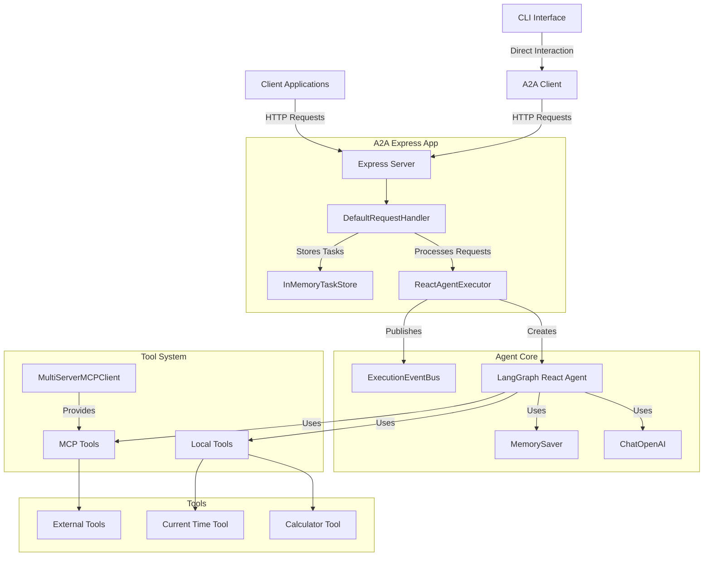

# Architecture Analysis Report

## Summary
The codebase implements a TypeScript-based ReAct agent using LangGraph that follows the A2A (Agent-to-Agent) protocol. It exposes agent capabilities through an Express HTTP server and provides both programmatic and CLI interfaces for interaction. The architecture follows a modular design with clear separation between the agent's core logic, communication protocols, and tool implementations.

## Entry Points
- `src/index.ts` → Main HTTP server entry point exposing A2A endpoints
- `src/cli.ts` → Command-line interface for interacting with the agent
- `src/a2a/executor.ts` → Core agent execution logic

## Architectural Style
The codebase follows a **Service-Oriented Architecture** with these key patterns:
- **Adapter Pattern**: Integration with external tools via MCP adapters
- **Facade Pattern**: A2A SDK abstracts complex agent interactions
- **Observer Pattern**: Event-based communication via EventBus
- **Command Pattern**: Tool execution through standardized interfaces

## Architecture Diagram


## UI/Backend Violations
None detected. The codebase follows a clean separation between:
- Frontend interfaces (CLI client)
- Backend logic (agent executor and tools)
- API endpoints (Express server routes)

## Details

### Main Entry Points Analysis

#### HTTP Server (`src/index.ts`)
The main entry point creates an Express server that implements the A2A protocol. Key components:
- `InMemoryTaskStore`: Stores task state and history
- `ReactAgentExecutor`: Core execution logic for the agent
- `DefaultRequestHandler`: Processes incoming A2A requests
- `A2AExpressApp`: Sets up HTTP routes for the A2A protocol

```typescript
// src/index.ts:15-23
async function main() {
  // 1. Create TaskStore
  const taskStore: TaskStore = new InMemoryTaskStore();

  // 2. Create AgentExecutor with MCP support
  const agentExecutor: ReactAgentExecutor = new ReactAgentExecutor();

  // 3. Create DefaultRequestHandler
  const requestHandler = new DefaultRequestHandler(
    agentCard,
    taskStore,
    agentExecutor
  );
```

#### CLI Interface (`src/cli.ts`)
Provides a command-line interface for interacting with an A2A-compatible agent. Features:
- Interactive text-based communication
- Session management with context/task tracking
- Colorized output for different message types
- Support for streaming responses

### Core Components

#### ReactAgentExecutor (`src/a2a/executor.ts`)
The central component that:
1. Creates and manages the LangGraph React agent
2. Processes user messages and maintains conversation context
3. Handles task execution lifecycle (start, update, complete)
4. Manages streaming responses and state updates
5. Integrates with MCP for external tool access

```typescript
// src/a2a/executor.ts:20-29
export class ReactAgentExecutor implements AgentExecutor {
  private cancelledTasks = new Set<string>();
  private llm: ChatOpenAI;
  private agent: any; // Type for the React agent
  private memorySaver: MemorySaver;
  private mcpClient: MultiServerMCPClient | null = null;

  constructor() {
    this.llm = new ChatOpenAI({ temperature: 0 });
    this.memorySaver = new MemorySaver();
    this.initializeAgent();
  }
```

#### Agent Card (`src/a2a/agentCard.ts`)
Defines the agent's capabilities, metadata, and skills according to the A2A protocol:

```typescript
// src/a2a/agentCard.ts:11-19
export const agentCard: AgentCard = {
  name: 'React ReAct Agent',
  description: 'LangGraph-powered ReAct agent exposed over A2A',
  url: 'http://localhost:3000/',
  version: '1.0.0',
  defaultInputModes: ['text'],
  defaultOutputModes: ['text'],
  capabilities: { streaming: true } as AgentCapabilities,
  skills,
};
```

### Tool System

#### Local Tools (`src/a2a/tools.ts`)
Defines built-in tools available to the agent:
- Calculator: Performs basic arithmetic operations
- Current Time: Returns the current date and time

```typescript
// src/a2a/tools.ts:4-22
export const calculatorTool = new DynamicStructuredTool({
  name: 'calculator',
  description: 'Useful for performing mathematical calculations',
  schema: z.object({
    operation: z.enum(['add', 'subtract', 'multiply', 'divide']),
    a: z.number().describe('First number'),
    b: z.number().describe('Second number'),
  }),
  func: async ({ operation, a, b }) => {
    let result: number;
    switch (operation) {
      case 'add':
        result = a + b;
        break;
      // ...other operations
    }
    return `Result of ${operation}(${a}, ${b}) = ${result}`;
  },
});
```

#### MCP Integration (`src/a2a/mcp/client.ts`)
Provides extensibility through the Model Completion Protocol (MCP), allowing the agent to access external tools:

```typescript
// src/a2a/mcp/client.ts:17-38
export async function createMCPClient() {
  // Load MCP server configurations from JSON file
  const configPath = path.join(__dirname, 'mcp-servers.json');
  let mcpServers = {};
  
  try {
    const configData = fs.readFileSync(configPath, 'utf8');
    mcpServers = JSON.parse(configData);
    console.log(`[MCP] Loaded server configurations from ${configPath}`);
  } catch (error) {
    console.error(`[MCP] Error loading server configurations from ${configPath}:`, error);
    console.warn('[MCP] No MCP servers will be available');
    // Empty object means no servers will be configured
    mcpServers = {};
  }

  // Create client and connect to server
  const client = new MultiServerMCPClient({
    // Global tool configuration options
    throwOnLoadError: true,
    prefixToolNameWithServerName: true,
    additionalToolNamePrefix: "mcp",
    useStandardContentBlocks: true,

    // Server configuration loaded from JSON
    mcpServers
  });
```

### Key Architectural Insights

1. **Protocol-Based Interoperability**: The codebase implements the A2A protocol, allowing it to interoperate with other A2A-compatible agents and clients.

2. **Extensible Tool System**: The architecture supports both built-in tools and external tools via MCP, making the agent capabilities extensible.

3. **Event-Driven Communication**: The agent uses an event bus system to publish task updates and status changes, enabling real-time communication.

4. **Streaming Support**: The architecture supports streaming responses, allowing for more interactive agent experiences.

5. **Graceful Degradation**: The MCP client implementation includes fallback mechanisms when external tools are unavailable.

6. **Clean Separation of Concerns**:
   - Protocol handling (A2A Express App)
   - Agent logic (ReactAgentExecutor)
   - Tool execution (Local Tools + MCP)
   - State management (TaskStore)
   - Client interfaces (CLI)

## Confidence Level
**High**: The architecture analysis is based on direct examination of source code with clear patterns and well-documented components.